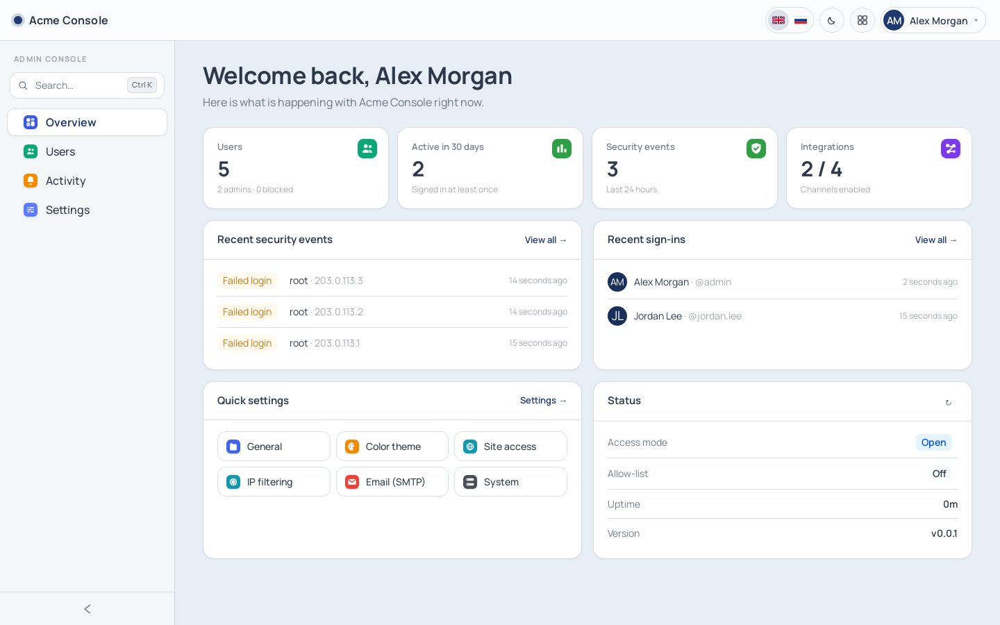
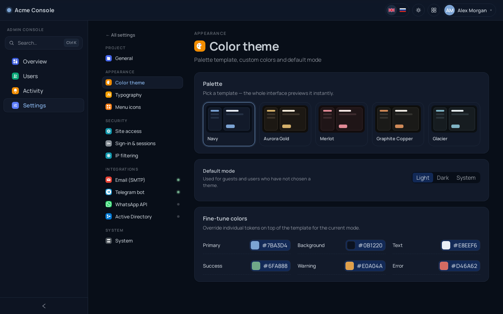
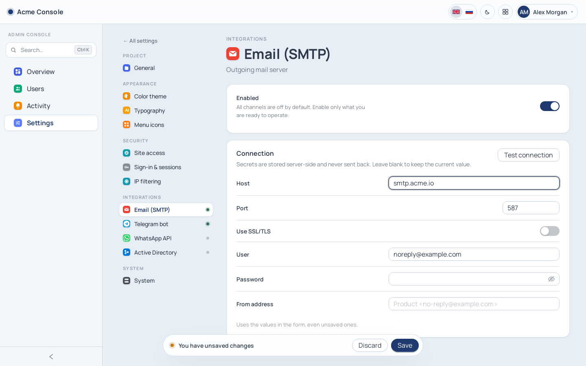
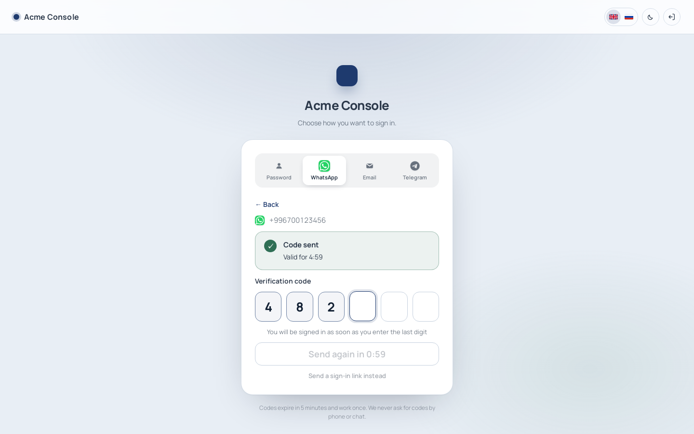
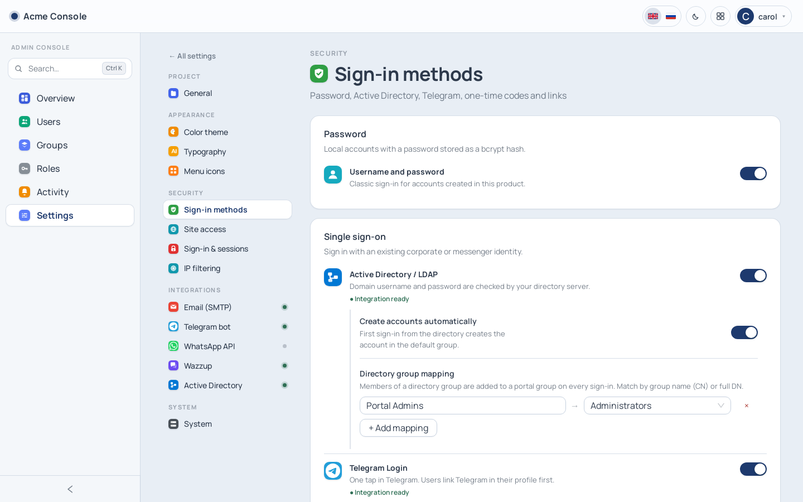
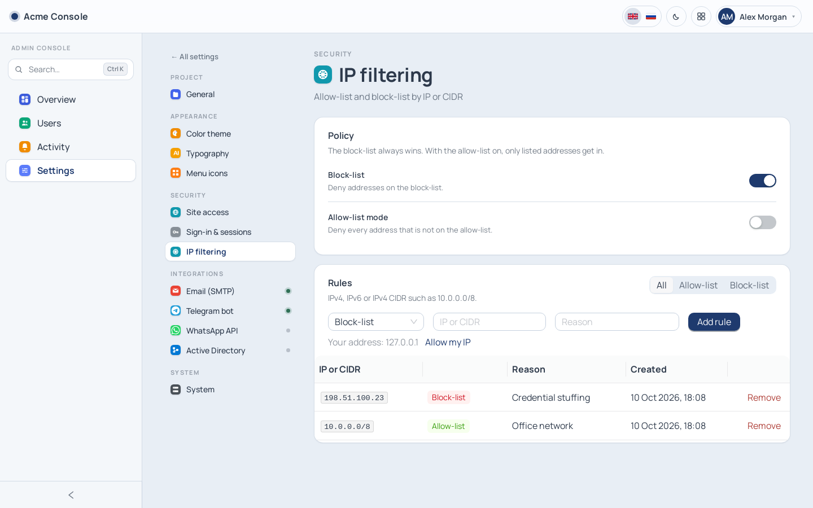
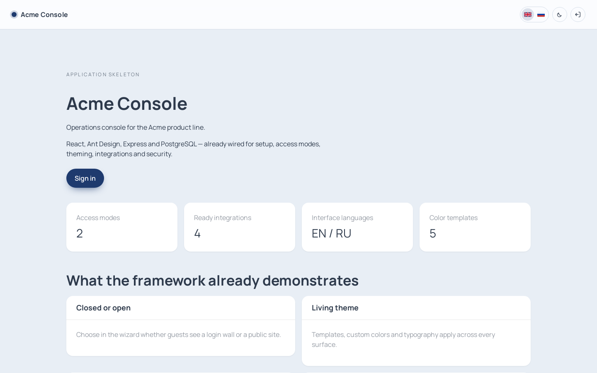
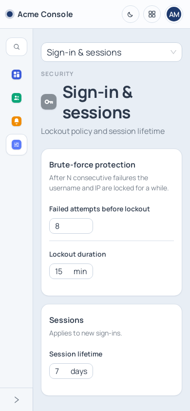

<div align="center">

# docker-app-skeleton

**A production-ready foundation for web products: sign-in, user cabinet, admin console and first-run wizard — already built, themed and secured.**

Clone it, connect PostgreSQL, finish `/setup`, and spend your time on the domain instead of on login screens.

[](https://github.com/iSmartyPRO/docker-app-skeleton/actions/workflows/ci.yml)
[](LICENSE)




</div>

---

## Contents

- [Why this exists](#why-this-exists)
- [Features](#features)
- [Screenshots](#screenshots)
- [Tech stack](#tech-stack)
- [Quick start](#quick-start)
- [Local development](#local-development)
- [Project structure](#project-structure)
- [The admin console](#the-admin-console)
- [Extending the skeleton](#extending-the-skeleton)
- [Configuration](#configuration)
- [Deploying behind a reverse proxy](#deploying-behind-a-reverse-proxy)
- [Security](#security)
- [Operations](#operations)
- [Testing and CI](#testing-and-ci)
- [Documentation](#documentation)
- [Roadmap](#roadmap)
- [Contributing](#contributing) · [License](#license)

---

## Why this exists

Almost every internal tool, client portal or SaaS MVP starts with the same three weeks of work: authentication, user management, roles, an admin panel, branding, settings storage, Docker packaging and a deploy story. Those weeks rarely get the care they deserve, and that is exactly where security holes and UX debt accumulate.

This repository is that work done once, properly:

- **Opinionated, not magical.** Plain Express + `pg` + React. No ORM, no meta-framework, nothing to unlearn.
- **Secure by default.** httpOnly sessions, bcrypt, lockouts, IP filtering, upload sniffing, self-lockout protection, a wizard that can't be re-opened.
- **Looks finished on day one.** A themeable design system, dark mode, EN/RU, a settings hub with search and a ⌘K command palette.
- **Built to be forked.** The admin structure is data: adding a settings screen is one registry entry and one component.

## Features

| Area | What you get |
|------|--------------|
| **First run** | Setup wizard: database → super administrator → open or closed site. Seeds roles and groups in the wizard's language and, optionally, sample users. Locks itself permanently once finished. |
| **Sign-in** | Password, Active Directory / LDAP (with group mapping and auto-provisioning), Telegram Login, 6-digit codes via WhatsApp (Wazzup), email or Telegram, and one-click magic links — each enabled per integration. Bank-style code entry that signs in on the last digit. |
| **Access control** | Roles built from a permission catalog, groups that grant roles, five built-in roles (Super administrator → User), escalation-proof assignment, last-super-admin protection, read-only settings for viewers. |
| **Sessions** | httpOnly `SameSite=Lax` JWT cookie, bcrypt (cost 12), per-user and per-IP lockout, rate limits, revocation on any access change, *sign out everywhere*. |
| **User cabinet** | Profile, avatar, phone and Instagram, language and theme, password (or first password for SSO users), Telegram linking, *sign out other devices*. |
| **Admin console** | Overview dashboard, user management (search, filters, roles, block/disable, password reset, revoke sessions), security activity log. |
| **Settings hub** | One searchable place for everything configurable: project identity and logos, color theme, typography, menu icons, site access, sign-in policy, IP filtering, integrations, system info and API limits. |
| **Design system** | 5 color templates × light/dark, custom color overrides, 28 typography presets, colored or monochrome icon sets, live preview before applying, separate logo for dark theme. |
| **UX details** | ⌘K / Ctrl+K command palette, floating *unsaved changes* bar, skeleton states, retryable errors, responsive down to phones, EN/RU with fallback. |
| **Security controls** | IP allow-list / block-list (IPv4/IPv6, IPv4 CIDR), guards against locking yourself out, last-admin protection, upload magic-byte checks, strict CSP. |
| **Integrations** | Email (SMTP), Telegram bot, WhatsApp gateway, [Wazzup](https://wazzup24.com) (WhatsApp, Telegram, Instagram, Avito), Active Directory — configuration, write-only secrets and *test connection*, off by default. |
| **Operations** | Single production container (nginx + Node), hot-reload dev stack, `/health` and `/ready`, Makefile for every routine task, semver `VERSION` baked into the image. |

## Screenshots

| Settings hub | Command palette (⌘K) |
|---|---|
|  |  |
| **Live theme preview (dark)** | **Unsaved-changes bar** |
|  |  |
| **Sign-in with a one-time code** | **Roles and permissions** |
|  |  |
| **Sign-in methods** | **User management** |
|  |  |
| **IP filtering with self-lockout guard** | |
|  | |
| **Public landing (open mode)** | **Mobile** |
|  |  |

## Tech stack

| Layer | Choice |
|-------|--------|
| Frontend | React 18, React Router 6, Ant Design 5, Vite 5, axios |
| Backend | Node.js 22 LTS, Express 4, `pg`, jsonwebtoken, bcryptjs, helmet, express-rate-limit, multer, nodemailer |
| Database | PostgreSQL 14+ (external — one server can host many apps) |
| Runtime | One Docker image: nginx serves the SPA and proxies `/api` to Node |
| Tooling | Docker Compose, Make, GitHub Actions, `node:test` |

## Quick start

**Requirements:** Docker Engine with Compose v2, and a PostgreSQL 14+ instance the container can reach.

```bash
git clone https://github.com/iSmartyPRO/docker-app-skeleton.git my-product
cd my-product

make env                       # creates .env and generates JWT_SECRET
$EDITOR .env                   # FRONTEND_URL, DOCKER_NAME, DOCKER_PORT, POSTGRES_*
docker network create docker-lan 2>/dev/null || true
make up                        # build and start the production container
make health
```

Open `http://127.0.0.1:8092` (or your `DOCKER_PORT`). You are redirected to the **setup wizard**:

1. **Database** — host, database, user, password → *Test* → *Save*. Credentials are written to `.env` and tables are created.
2. **Administrator** — username (3–32 chars, `[A-Za-z0-9._-]`), password (10+ chars).
3. **Access** — **Closed** (everyone sees the sign-in form) or **Open** (public landing; cabinet and console stay private).

> [!IMPORTANT]
> If the port can be reached by others before you finish the wizard, set `SETUP_TOKEN` in `.env` first. Once setup completes, the app writes `SETUP_LOCKED=true` to `.env` and the wizard can never be reopened — not even during a database outage.

Need a database? See [docs/postgres.md](docs/postgres.md).

## Local development

**With Docker (recommended)** — source is bind-mounted, both servers hot-reload:

```bash
make dev
```

| URL | Service |
|-----|---------|
| http://127.0.0.1:3020 | Vite dev server (UI) |
| http://127.0.0.1:3021 | Express API |

Run `make dev-rebuild` after changing a `package.json`.

**On the host** — Node 22 and a reachable PostgreSQL:

```bash
make install                                   # npm ci in both packages
cd src/backend  && npm run dev                 # API on :3001 (reads ../../.env)
cd src/frontend && npm run dev                 # UI on :3000, proxies /api to :3001
make test                                      # unit tests + production build
```

## Project structure

```
.
├── Dockerfile · Dockerfile.dev · docker-compose*.yml · nginx.conf
├── Makefile                    # every routine task: env, up, dev, logs, bump, db helpers
├── VERSION                     # single source of the app version
├── docs/                       # guides (see Documentation below)
└── src/
    ├── backend/
    │   ├── config/             # env bootstrap, PostgreSQL pool, paths, version
    │   ├── middleware/         # auth, IP guard, setup guard, uploads, errors
    │   ├── routes/             # auth, setup, account, admin, public
    │   ├── services/           # users, settings, security, setup, overview, integrations
    │   └── test/               # node:test unit tests
    └── frontend/src/
        ├── admin/              # navigation registry + settings page map  ← the console structure
        ├── components/         # Chrome (header), CommandPalette, icons, ui/ kit
        ├── context/            # Auth, Settings, Locale, Theme providers
        ├── hooks/              # useAdminSettings, useSettingsForm
        ├── i18n/               # EN / RU dictionaries
        ├── layouts/            # Public, Account, Admin, Settings
        ├── lib/                # errors, formatting, search helpers
        ├── pages/              # Home, Login, SetupWizard, account/*, admin/*, admin/settings/*
        └── theme/              # color templates, typography presets
```

## The admin console

The sidebar adapts to the user's permissions; everything configurable lives under **Settings**.

```
Overview        KPIs, recent security events, recent sign-ins, quick links, status
Users           search · role/group/status filters · user page (profile, sign-in contacts, groups, roles, sessions)
Groups          teams and the roles they grant; members; default group
Roles           permission matrix per role; built-in and custom roles
Activity        security events for 90 days with 24-hour counters
Settings        searchable hub
  ├─ Project        General — name, description, primary + dark-theme logo, logo height
  ├─ Appearance     Color theme · Typography · Menu icons
  ├─ Security       Sign-in methods · Site access · Sign-in & sessions · IP filtering
  ├─ Integrations   Email · Telegram · WhatsApp · Wazzup · Active Directory
  └─ System         Version, runtime, database, API rate limit
```

Every settings screen follows the same pattern — a header with group and icon, card sections with *label left, control right* rows, and a floating bar that appears only when something changed. Appearance screens preview live across the whole UI before you apply them. Old URLs from earlier versions (`/admin/general`, `/admin/security/ip`, …) redirect automatically.

## Extending the skeleton

The console is driven by a registry, [`src/frontend/src/admin/navigation.js`](src/frontend/src/admin/navigation.js). The sidebar, settings hub, settings navigation, command palette and icon editor are all generated from it.

Adding a settings screen takes three steps:

```js
// 1. admin/navigation.js — add an item to a group
{ id: 'billing', defaultIcon: 'chart', keywords: 'billing invoices stripe' }

// 2. admin/settingsPages.js — register the component (lazy-loaded chunk)
billing: lazy(() => import('../pages/admin/settings/Billing')),

// 3. i18n/translations.js — settings.billing.title / .desc in en and ru
```

The screen itself is built from the UI kit: `SettingsPageHeader`, `SettingsSection` + `SettingRow`, `useSettingsForm` and `SaveBar`.

Recipes for API endpoints, settings keys, top-level pages, color templates and integrations: **[docs/extending.md](docs/extending.md)**. Renaming and branding a fork: **[docs/adapt.md](docs/adapt.md)**.

## Configuration

Bootstrap configuration lives in `.env` (gitignored; template: [`.env.example`](.env.example)). Everything else — name, logos, theme, integrations, security policy — is stored in PostgreSQL and edited in the console.

| Variable | Default | Purpose |
|----------|---------|---------|
| `DOCKER_NAME` / `DOCKER_PORT` | `docker-app-skeleton` / `8092` | Container name and published HTTP port |
| `FRONTEND_URL` | `http://localhost:8092` | Public origin: CORS, and `Secure` cookies when `https://` |
| `JWT_SECRET` | generated by `make env` | Session signing key — **required** in production |
| `POSTGRES_*` / `DATABASE_URL` | — | Database connection (the wizard can write `POSTGRES_*`) |
| `TRUST_PROXY_HOPS` | `1` | Reverse proxies in front of Express (see below) |
| `SETUP_TOKEN` | unset | Shared secret required by the wizard |
| `SETUP_LOCKED` | written by the app | Keeps the wizard closed after setup |
| `COOKIE_SECURE` | unset | Force `Secure` cookies when TLS terminates upstream |
| `SEED_LOCALE` | first user's language | Language of the default groups created on upgrade (`en` / `ru`) |
| `TZ` / `UPLOAD_DIR` | `UTC` / `/app/uploads` | Timezone, avatar and logo storage |

Full reference: [docs/configuration.md](docs/configuration.md).

## Deploying behind a reverse proxy

The container already runs nginx, which counts as **one** proxy hop. If you put another proxy in front (host nginx, Traefik, Nginx Proxy Manager, Cloudflare), set:

```env
FRONTEND_URL=https://app.example.com
TRUST_PROXY_HOPS=2
```

and make sure the outer proxy forwards the client address:

```nginx
location / {
    proxy_pass         http://127.0.0.1:8092;
    proxy_set_header   Host              $host;
    proxy_set_header   X-Real-IP         $remote_addr;
    proxy_set_header   X-Forwarded-For   $proxy_add_x_forwarded_for;
    proxy_set_header   X-Forwarded-Proto $scheme;
}
```

> [!WARNING]
> With the wrong hop count every visitor appears to have the proxy's IP: one brute-force attempt locks out everyone, and IP allow-lists stop working. Too high a value lets clients spoof their IP. Count your proxies.

## Security

Highlights — the full threat model and go-live checklist are in [docs/security.md](docs/security.md):

- **Access control:** permission-checked routes, no privilege escalation (you can only grant what you hold), stronger accounts are read-only to you, and the product can never lose its last super administrator. Details: [docs/access-control.md](docs/access-control.md).
- **Sign-in codes:** 6 digits, 5 minutes, single use, 5 attempts, hashed at rest, resend limits, no account enumeration; magic-link tokens never reach server logs.
- **Sessions:** httpOnly, `SameSite=Lax`, `Secure` on HTTPS. Password change, access change, disabling, blocking and *sign out everywhere* invalidate every outstanding token.
- **Brute force:** login limiter plus separate lockout streaks per username and per IP. Failures look identical to the client.
- **Setup wizard:** optional `SETUP_TOKEN`, rate-limited writes, permanently locked after completion.
- **Foot-gun guards:** the API refuses changes that would block the acting admin's own IP (`409 SELF_LOCKOUT`), and nobody can demote, disable, block or delete the last active administrator or their own account.
- **Data:** parameterized SQL everywhere, integration secrets are write-only (masked in every response), public settings never contain secrets.
- **Uploads:** random names, size limits, magic-byte verification, SVGs with scripts or event handlers rejected, `/uploads/` served with `CSP: default-src 'none'`.

Report vulnerabilities privately — see [SECURITY.md](SECURITY.md).

## Operations

```bash
make help            # list every target
```

| Task | Command |
|------|---------|
| Start / stop / rebuild production | `make up` · `make down` · `make rebuild` |
| Health, readiness, status | `make health` · `make ready` · `make status` |
| Logs and shell | `make logs` · `make logs-tail LINES=200` · `make shell` |
| Development stack | `make dev` · `make dev-logs` · `make dev-down` |
| Release a version | `make bump-patch` (or `-minor`, `-major`) → `make rebuild` |
| Database helpers | `make psql` · `make sql SQL="SELECT 1"` · `make db-setup PASSWORD=…` |
| Sample users | `make seed-demo` (no passwords; for demos and staging) |

Backups, upgrades and troubleshooting: [docs/operations.md](docs/operations.md).

## Testing and CI

```bash
make test                      # backend unit tests + frontend production build
cd src/backend && npm test     # node:test only
```

GitHub Actions ([`.github/workflows/ci.yml`](.github/workflows/ci.yml)) runs on every push and pull request: `npm ci`, backend syntax check and unit tests, and a production build of the frontend. Dependencies are pinned with lock files; Docker images install with `npm ci`.

## Documentation

| Guide | Contents |
|-------|----------|
| [Getting started](docs/getting-started.md) | From `git clone` to a running product |
| [Architecture](docs/architecture.md) | Request flow, data model, frontend areas, UI kit |
| [Extending](docs/extending.md) | Recipes: settings screens, pages, endpoints, templates, integrations |
| [Adapting a fork](docs/adapt.md) | Renaming, branding and what not to rewrite |
| [Access control & sign-in](docs/access-control.md) | Roles, groups, permissions, safety rules, sign-in methods and their setup |
| [Integrations](docs/integrations.md) | Email, Telegram, WhatsApp, Wazzup and Active Directory setup |
| [Configuration](docs/configuration.md) | Environment variables and stored settings |
| [Security](docs/security.md) | Threat model, built-in controls, go-live checklist |
| [Operations](docs/operations.md) | Make targets, backups, upgrades, troubleshooting |
| [HTTP API](docs/api.md) | Every endpoint with its guard |
| [PostgreSQL](docs/postgres.md) | Creating the role and database |
| [Publishing to GitHub](docs/github.md) | First push without leaking secrets |
| [Architecture review](docs/audit.md) | Review findings, what changed and why |
| [Changelog](CHANGELOG.md) | Notable changes per version |

## Roadmap

Planned next steps, in priority order (details in [docs/audit.md](docs/audit.md#recommended-next-steps)):

- [ ] Encrypt integration secrets at rest
- [ ] Versioned SQL migrations
- [ ] Admin action audit trail
- [ ] Schema validation for request bodies (zod)
- [ ] End-to-end tests with Playwright
- [ ] Structured logging with request IDs
- [ ] TOTP two-factor authentication and passkeys

## Contributing

Contributions that keep the skeleton small, secure and easy to fork are welcome. Read [CONTRIBUTING.md](CONTRIBUTING.md) before opening a pull request; security-sensitive changes need a short threat note.

## License

[MIT](LICENSE) © docker-app-skeleton contributors. Developed by [iSmartyPro](https://www.ismarty.pro).
